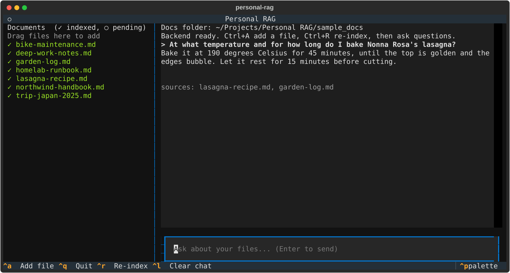
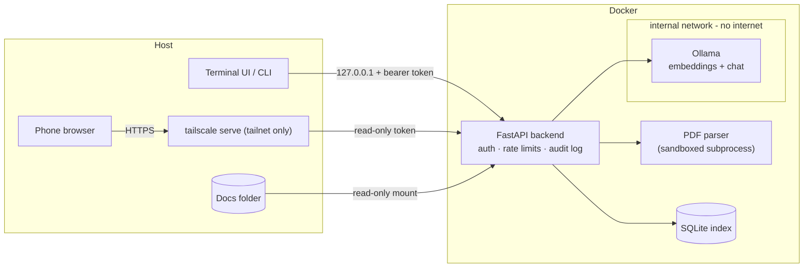

# Personal RAG

[](https://github.com/JonaszWD/personal-RAG/actions/workflows/ci.yml)


[](LICENSE)

**Ask questions about your own files — privately.** A local-first retrieval-augmented generation (RAG) system where
documents, embeddings and the language model never leave your machine. Built as a security-focused proof of concept:
small scope, hardened by default, measured rather than assumed.



## Highlights

- **100% local.** Embeddings (`nomic-embed-text`) and chat (`llama3.2:3b`) run in [Ollama](https://ollama.com) on an
  internal Docker network with **no internet access**. No cloud APIs, no telemetry.
- **Security first.** Read-only document mount, sandboxed PDF parsing, prompt-injection-aware prompting, two-tier auth,
  hardened containers. See [SECURITY.md](SECURITY.md).
- **Three ways in.** A full-screen terminal UI with multi-select file picker and drag-and-drop, a scriptable CLI, and
  a read-only mobile web UI reachable from your phone over Tailscale.
- **Robust ingestion.** Incremental (content-hash) indexing as a background job with live progress; one bad file never
  aborts the batch.
- **Engineered like a product.** `mypy --strict`, 49 tests (82% coverage), ruff, pre-commit, dependency audit,
  container scan and secret scan in CI, a retrieval/answer **evaluation harness**, and architecture docs.

## Architecture



Details and design rationale: [docs/ARCHITECTURE.md](docs/ARCHITECTURE.md).

## Scope (deliberately small)

`.txt` / `.md` (≤ 1 MB) and text-based `.pdf` (≤ 10 MB, first 100 pages); up to 200 files from **one** folder. No Office
formats, no OCR, no encrypted PDFs. Each new format is a new attack surface, so formats are added one at a time.

## Quick start

Requires Docker, [uv](https://docs.astral.sh/uv/) and ~3 GB of disk for the models.

```bash
git clone https://github.com/JonaszWD/personal-RAG && cd personal-RAG
uv tool install --editable ".[tui]"       # installs the `personal-rag` command
make models                               # one-time model download
personal-rag                              # starts the stack and opens the UI
```

First run creates `.env` (random tokens, mode 0600) and starts Docker automatically. Your files go in `documents/`
(git-ignored) or any folder set via `RAG_DOCS_HOST_DIR`. Try it immediately with the bundled synthetic corpus:
`RAG_DOCS_HOST_DIR=./sample_docs personal-rag`.

| Key / action | What it does |
|---|---|
| **Drag & drop** | Drop files or folders into the terminal window; they are validated, copied in and indexed |
| **Ctrl+A** | Picker: **Space** marks files *and folders*, **Ctrl+S** adds all marked |
| **Ctrl+R** | Re-index (also retries failed files) |
| Type + Enter | Ask a question; answers cite their source files |

Scripting: `personal-rag ingest`, `personal-rag ask "question"`. If port 8000 is taken, set `RAG_PORT=8800` in `.env`.

### From your phone (read-only)

Private by design: reachable only over your [Tailscale](https://tailscale.com) network, never the public internet.

1. Install Tailscale on the Mac and the phone.
2. `personal-rag remote` prints the read-only token and the exact commands.
3. Add `RAG_ALLOWED_HOSTS=<mac>.<tailnet>.ts.net` to `.env`, `docker compose up -d`, then `tailscale serve --bg 8800`.
   **Never `tailscale funnel`** (that is public).
4. Open `https://<mac>.<tailnet>.ts.net/` on the phone and sign in with the remote token.

The phone can ask questions and list documents; it cannot index or add files (the full token never leaves the Mac).

## Evaluation

`make eval` runs retrieval and answer checks on a synthetic corpus (`sample_docs/`, 7 fictional documents) with 16
labelled questions (`eval/questions.json`), inside the container so it reaches Ollama like production does.

| Metric | Result |
|---|---|
| Retrieval hit@1 / hit@4 (14 answerable Qs) | 100% / 100% |
| MRR | 1.00 |
| Answer accuracy (expected keyword present) | 14 / 14 |
| Correct abstention on unanswerable Qs | 2 / 2 |

*Honest caveat:* this is a small, easy benchmark (distinct topics, one fact per question), so it works as a regression
test and sanity check, **not** as evidence of state-of-the-art quality. Harder cases (near-duplicate documents,
multi-document questions, long PDFs) are the next step — see the roadmap. Config: `nomic-embed-text`, `llama3.2:3b`,
1000-char chunks with 150 overlap, top-4.

## Security model (summary)

| Threat | Mitigation |
|---|---|
| Data exfiltration | Local models only; Ollama on an `internal: true` Docker network |
| Reaching the API | Loopback-only port; bearer token (≥ 32 chars, constant-time compare) |
| Reading files outside scope | Single `:ro` mount; symlinks, hidden files, unknown types rejected; size/count caps |
| Malicious PDFs | Parsed in a rlimit-bound child process: empty env, stdin bytes only, timeout, page/output caps |
| Prompt injection from documents | Excerpts delimited and labelled untrusted; the model has no tools |
| Terminal / UI injection | Backend text rendered as plain text, control characters stripped |
| Stolen phone | Separate read-only token, HttpOnly + `__Host-` cookie, lockout, revoke by rotating the token |
| Container compromise | Non-root, read-only rootfs, all capabilities dropped, no-new-privileges, pid/memory limits |
| Supply chain | Locked deps, Dependabot, `pip-audit`, Trivy image scan, gitleaks |

Full threat model, residual risks and reporting: [SECURITY.md](SECURITY.md).

## Development

```bash
make install     # deps + git hooks
make check       # ruff, mypy --strict, pytest with coverage gate (≥ 80%)
make eval        # quality evaluation (needs the stack + models)
make help        # everything else
```

CI (`.github/workflows/ci.yml`): lint → format → types → tests + coverage → dependency audit → Docker build →
Trivy scan → secret scan; images are pushed to GHCR on `v*` tags. Contribution notes: [CONTRIBUTING.md](CONTRIBUTING.md).

```
src/personal_rag/
  api.py        FastAPI app: auth, middleware, endpoints
  auth.py       sliding-window rate limiter, session store
  ingest.py     chunk → embed → store; background job with progress
  rag.py        retrieval and prompt construction
  store.py      SQLite + brute-force cosine search (thread-safe)
  pdf.py        sandboxed PDF extraction (+ pdf_worker.py child)
  security.py   path / file safety checks
  tui.py cli.py project.py   terminal UI, CLI, host-side helpers
  web/          mobile web UI (static, CSP-compatible)
  evaluate.py   evaluation harness
```

## Limitations and roadmap

- Brute-force vector search is fine for hundreds of files, not millions → swap in an ANN index (sqlite-vec / HNSW).
- Small local models are slow on CPU and can miss; retrieval quality is measured, generation quality is model-bound.
- Harder evaluation set and retrieval improvements (hybrid BM25 + vectors, re-ranking, page-aware PDF chunks).
- OCR for scanned PDFs, in a separate sandboxed container.
- Phone uploads via a separate writable inbox volume.
- The backend container shares a bridge for its published port, so it has egress it does not need — tighten with an
  egress proxy.

## License

[MIT](LICENSE)
